# Weekly Jira report

My solution for the Jira test assignment. A Python script reads one Jira Cloud project through the REST API and emails the project lead a weekly report with three lists: issues created, issues resolved and issues open now. GitHub Actions runs it every Monday at 10:00 Berlin time. There is no Jira Automation and no server of mine.

## How it works

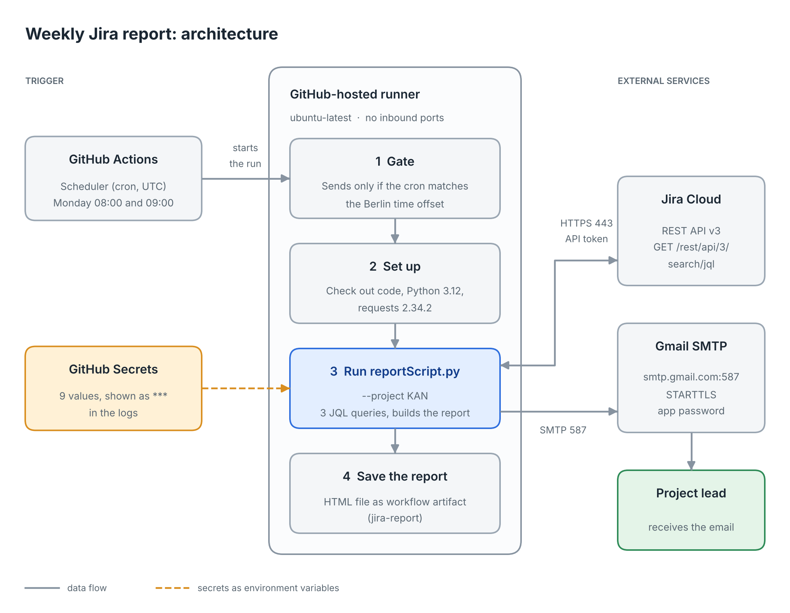

1. GitHub Actions starts the workflow from a cron schedule.
2. A gate step decides if this run may send the report. This handles daylight saving time (see the schedule section).
3. The runner installs Python 3.12 and `requests`, then starts `reportScript.py`.
4. The script reads the secrets from environment variables, runs three JQL queries and builds the report.
5. The script sends the report by SMTP and saves the HTML as a workflow artifact.

The three queries (the end day is included):

| List | JQL |
|---|---|
| Created | `project = "KAN" AND created >= "<start>" AND created < "<end + 1 day>"` |
| Resolved | `project = "KAN" AND resolved >= "<start>" AND resolved < "<end + 1 day>"` |
| Open now | `project = "KAN" AND statusCategory != Done` |

"Open now" is the state at the time of the run. The type and priority filters apply to all three lists. The script follows `nextPageToken`, so it gets every issue even when there are more than 100. Each issue key in the email links to the issue in Jira.

## Compute resources, permissions and network

| Item | Value |
|---|---|
| Compute | A GitHub-hosted Linux virtual machine (`ubuntu-latest`). GitHub creates it for each run and deletes it afterwards. |
| Runtime | Python 3.12 and requests 2.34.2 |
| GitHub permissions | The workflow asks only for `contents: read`. The repository is private. |
| Jira permissions | The user behind the API token needs the *Browse projects* permission on the project. The token has the rights of that user. |
| Mail permissions | A Gmail app password. It is used only to send mail through SMTP. |
| Network, outbound | HTTPS 443 to `<your-site>.atlassian.net`. SMTP 587 to `smtp.gmail.com`. The setup steps also reach GitHub and PyPI. |
| Network, inbound | None |
| Secrets | Nine GitHub Actions secrets (step 6). They are not in the code or in the repository. GitHub masks them as `***` in the logs. |

## External tools

| Tool | What it does here | How it is used |
|---|---|---|
| Jira Cloud (free plan) | Holds the project and the issues, and offers the REST API | Sign up, create the space, create the issues, create an API token (steps 1 to 3). The script calls `GET /rest/api/3/search/jql` with the token. |
| GitHub (private repository) | Keeps the code and the secrets | Push the files and add nine secrets (steps 5 and 6). |
| GitHub Actions | Starts the workflow on a schedule and on demand, and runs it on a hosted runner | Steps: gate, check out the code (`actions/checkout@v4`), install Python (`actions/setup-python@v5`), `pip install requests`, run the script, save the HTML report (`actions/upload-artifact@v4`). |
| Gmail SMTP | Delivers the report email | Turn on 2-Step Verification and create an app password (step 4). The script logs in to `smtp.gmail.com` on port 587 with STARTTLS. |
| Python and requests | Run the script and talk to the Jira API | The workflow installs both on every run. |

## Tested with

| Part | Version |
|---|---|
| Browser for Jira, GitHub and Gmail | Google Chrome 155.0.8059.82 (Official Build, Stable, 64-bit) |
| My computer | Windows 10 Pro, version 22H2 (OS build 19045.7807) |
| Runner | `ubuntu-latest` on GitHub Actions, Python 3.12 |
| requests | 2.34.2 (with urllib3 2.8.0, certifi 2026.10.19, idna 3.20, charset_normalizer 3.5.2) |
| Jira | Jira Cloud, free plan, team-managed space |

## Setup, step by step

You need a web browser. You do not need to know Jira. Every click is written down.

### 1. Create a Jira Cloud site and a project

1. Go to <https://www.atlassian.com/software/jira> and sign up for the free plan. Choose a site name. Your site address is `https://<your-site>.atlassian.net`.
2. In Jira, create a project (the new screens call it a *space*). I used the **IT service** template, which gives the issue types Incident and Service request. I named the space `My IT Team` with the key `KAN`. The person who creates the space becomes its lead. My lead is Serhat Bicimli (srhtbcml@gmail.com). Screenshot 12 shows the space, the key and the lead.
3. Set your Jira time zone to `Europe/Berlin` in your profile settings. Jira reads the dates of a query in the time zone of the user. With this setting, "today" in Jira and "today" in the script mean the same day.

### 2. Create sample issues

The report needs data. I created six issues in the space:

| Key | Summary | Type | Priority | Final status |
|---|---|---|---|---|
| KAN-3 | Subtask 2.1 | Subtask | none | Waiting for Customer |
| KAN-4 | Login page error | Incident | High | To Do |
| KAN-5 | Slow search | Incident | Highest | To Do |
| KAN-6 | Typo in footer | Incident | Low | Resolved |
| KAN-7 | Add export button | Task | Medium | Resolved |
| KAN-8 | Update docs | Task | Low | Resolved |

To resolve an issue, open it and move the status to *Resolved*. Then check that the field **Resolution** shows *Done*. The "resolved" query uses the resolution date, so an issue without a resolution is not counted. (This happened to me once with KAN-6. I set the status again and the resolution appeared.)

My space has no issue type *Bug*. Use the types you have in the `--types` option.

### 3. Create a Jira API token

1. Open <https://id.atlassian.com/manage-profile/security/api-tokens>.
2. Click **Create API token**. Give it a label (I used `weekly-report`) and an expiry date.
3. Copy the token and keep it safe. Jira shows it only once.

### 4. Create a Gmail app password

1. In your Google account, turn on **2-Step Verification**.
2. Open <https://myaccount.google.com/apppasswords>, create an app password and copy the 16 characters.

### 5. Create the GitHub repository

1. Create a **private** repository, for example `jira-weekly-report`.
2. Add these files with exactly these names (Linux is case-sensitive): `reportScript.py`, `test_report.py`, `.github/workflows/weekly-report.yml`, `README.md`, `docs/architecture.png` and the folder `screenshots/`. The code of the first three files is in the [appendix](#appendix-the-code).
3. The workflow runs `python reportScript.py --project KAN`. If your project key is not `KAN`, change it in `weekly-report.yml`.

### 6. Add the secrets

In the repository open **Settings → Secrets and variables → Actions → New repository secret**. Add these nine secrets:

| Secret | Value |
|---|---|
| `JIRA_BASE_URL` | `https://<your-site>.atlassian.net` (no slash at the end) |
| `JIRA_EMAIL` | The email of your Atlassian account |
| `JIRA_API_TOKEN` | The token from step 3 |
| `SMTP_HOST` | `smtp.gmail.com` |
| `SMTP_PORT` | `587` |
| `SMTP_USER` | Your Gmail address |
| `SMTP_PASSWORD` | The app password from step 4 |
| `MAIL_FROM` | Your Gmail address |
| `MAIL_TO` | The email of the project lead |

### 7. First run

1. Open the **Actions** tab and click **Weekly Jira report**.
2. Click **Run workflow**, leave the text box empty and click the green **Run workflow** button.
3. Wait about 20 seconds. The run turns green and the email arrives in the inbox of `MAIL_TO`. If the run is red, open it and read the log.

## Options

In the box *Extra options* of **Run workflow** you can type any of these:

| Option | Meaning | Default |
|---|---|---|
| `--days N` | Look back N days from the end date | `7` |
| `--from YYYY-MM-DD` | First day (replaces `--days`) | none |
| `--to YYYY-MM-DD` | Last day, included | today in Berlin |
| `--types A,B` | Only these issue types | all |
| `--priorities A,B` | Only these priorities | all |
| `--no-email` | Print and save the report, send nothing | off |

Examples: `--days 30`, `--from 2026-10-01 --to 2026-10-15`, `--types Incident,Task --priorities High,Highest`. The email shows the active filters under the title.

## The schedule and daylight saving time

GitHub reads cron times in UTC. Berlin time changes twice a year, so the workflow has two cron lines:

| Season | Berlin offset | Cron for 10:00 Berlin |
|---|---|---|
| Summer time (CEST) | UTC+2 | `0 8 * * 1` |
| Winter time (CET) | UTC+1 | `0 9 * * 1` |

The first step, the gate, lets a run go on only if its cron fits the Berlin offset at that moment. The `0 8` run goes on at +0200. The `0 9` run goes on at +0100. A run you start by hand always goes on. So only one email is sent each Monday. The clocks change on Sunday 25 October 2026, so the first winter run is Monday 26 October at 09:00 UTC.

The gate looks at which cron started the run, not at the hour. GitHub can start a run late. A gate that checked the hour would skip a late run, and no email would go out.

## Error handling

| Situation | What the script does |
|---|---|
| A setting is missing | Stops with a clear message, for example `ERROR: environment variable JIRA_API_TOKEN is missing` |
| Network error or timeout | Tries up to 3 times, waits 2 s, 4 s and 6 s |
| Jira answers 429 or 5xx | Same retries. If Jira sends a `Retry-After` header, the script waits that long. |
| 401, 403 or 400 | Stops with a message: wrong login, no permission, or a query Jira rejected (with Jira's text) |
| Another HTTP error, for example 404 | Stops with the status code and the first 300 characters of Jira's answer |
| Jira sends something that is not JSON | Stops with a message |
| Start date after end date | Stops with a message |
| Email cannot be sent | Stops with the SMTP error |
| Missing summary, priority or type | Shows `(no summary)` or `-` and goes on |
| No issues in a list | The list shows "None" |

**Data warnings.** The script asks Jira for the creation date and the resolution date of each issue. It checks three things: an issue in the Resolved list has no resolution date, an issue in the Open now list has a resolution date, and an issue was resolved before it was created. An issue without a key is left out of the lists. Each finding shows once in a "Data warnings" section at the end of the email. Without findings the section does not appear.

**Tests.** `test_report.py` has 8 small tests with fake Jira answers. They need no network and no secrets. Run `python test_report.py`. The output ends with `All 8 tests passed.`

## Sample report and test evidence

Text version of the report from the scheduled run on 20 October 2026 (the Jira address is shortened):

```
Jira weekly report KAN: 2026-10-13 to 2026-10-20
Filters: types=all; priorities=all

Created: 6
Resolved: 3
Open now: 3

Created (6)
  KAN-8  Update docs  [Task, Low, Resolved]  https://<your-site>.atlassian.net/browse/KAN-8
  KAN-7  Add export button  [Task, Medium, Resolved]  https://<your-site>.atlassian.net/browse/KAN-7
  KAN-6  Typo in footer  [Incident, Low, Resolved]  https://<your-site>.atlassian.net/browse/KAN-6
  KAN-5  Slow search  [Incident, Highest, To Do]  https://<your-site>.atlassian.net/browse/KAN-5
  KAN-4  Login page error  [Incident, High, To Do]  https://<your-site>.atlassian.net/browse/KAN-4
  KAN-3  Subtask 2.1  [Subtask, -, Waiting for Customer]  https://<your-site>.atlassian.net/browse/KAN-3

Resolved (3)
  KAN-6, KAN-8, KAN-7

Open now (3)
  KAN-3, KAN-4, KAN-5
```

The email has the same data as HTML: three count boxes on top, then one table per list with links.

### What I tested

| Test | Result |
|---|---|
| First manual runs | Green, emails received, counts 6 / 3 / 3. One run used `--days 30 --types Incident --priorities High,Highest` and gave 2 / 0 / 2. |
| Runs #4 to #8, started by the schedule | GitHub's scheduler started them. The test gate skipped #4 to #7 (8 s, no email). Run #8 sent the email. |
| Run #9, manual, final workflow file | Green, email received, the gate log shows `Run the report: true` |
| Run #10, manual, final script | Green, email received, counts 6 / 3 / 3, no data warnings |
| `python test_report.py` | 8 of 8 tests passed (Python 3.12, Linux) |
| Gate logic | Checked with a local script for all four combinations of cron and offset, and for a manual start |

### Screenshots

#### Jira and GitHub setup

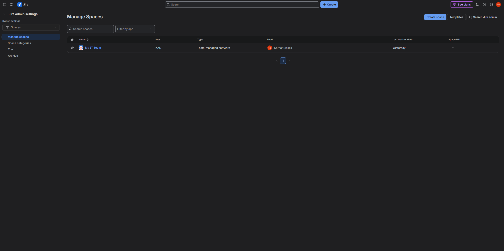

*12: The space My IT Team, key KAN, lead Serhat Bicimli.*

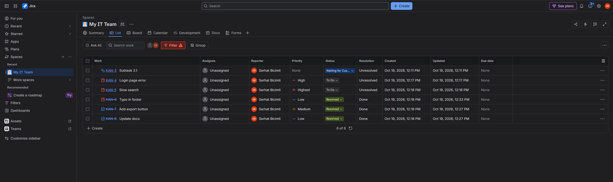

*01: The six sample issues. Resolution is Done for the resolved ones.*

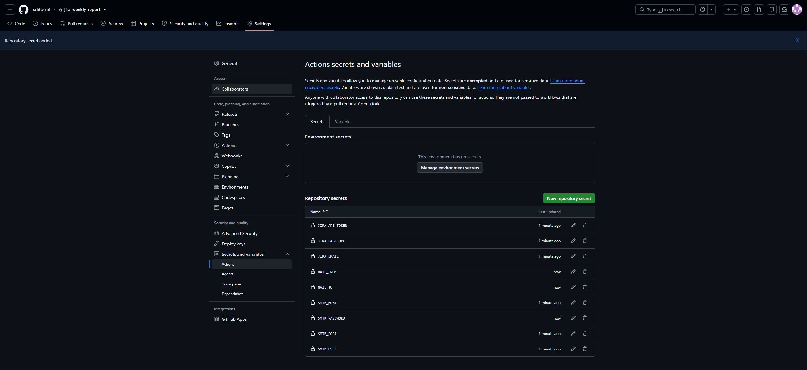

*02: The nine secret names (the values are hidden).*

#### Manual runs

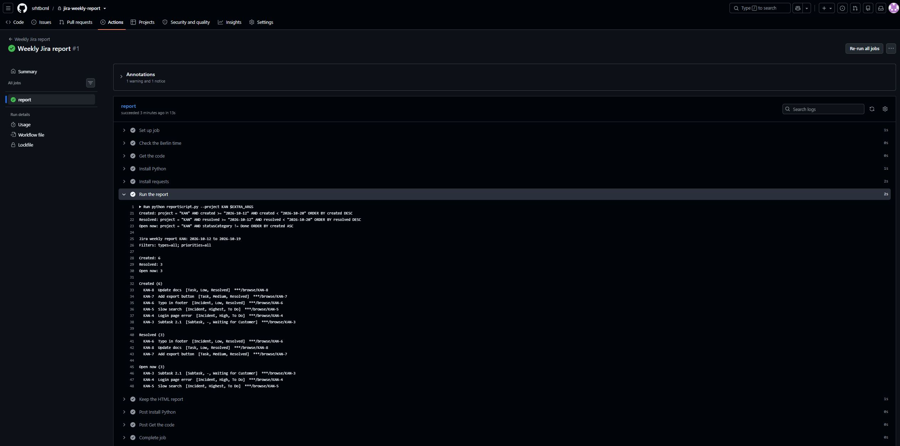

*03: Log of manual run #1. The Jira address is masked as `***`.*


*04: Report email from manual run #2 (13:27).*


*05: The same email with the header open: sender, recipient, date and subject.*

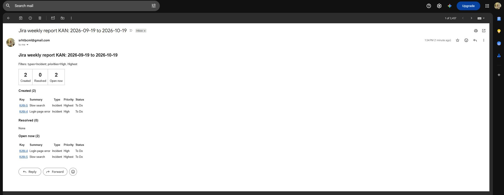

*06: Email from the filtered manual run with `--days 30 --types Incident --priorities High,Highest`.*

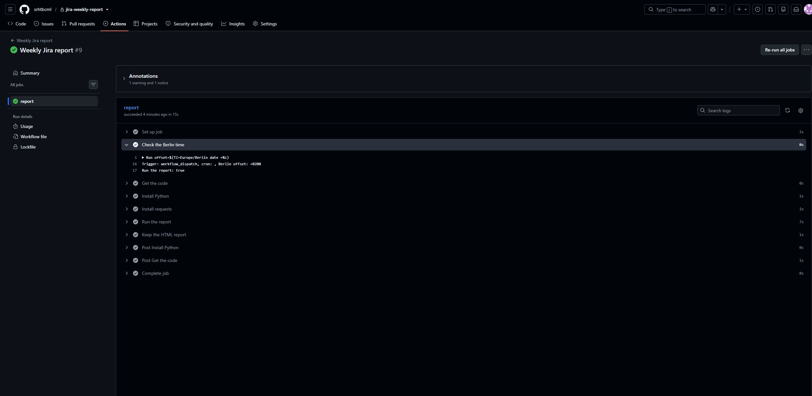

*11: Gate log of manual run #9 with the final workflow file.*

#### Scheduled runs

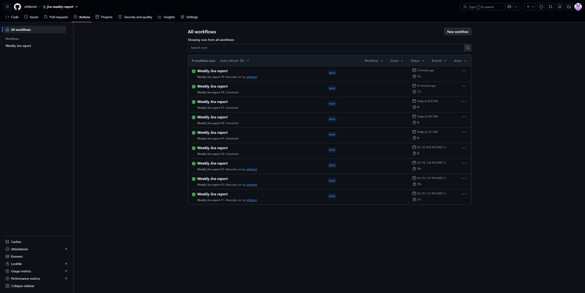

*07: Runs #4 to #7 were started by the schedule. They are short because the test gate skipped them.*

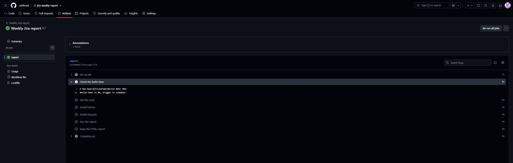

*08: Gate log of scheduled run #7. The gate skipped the other steps.*

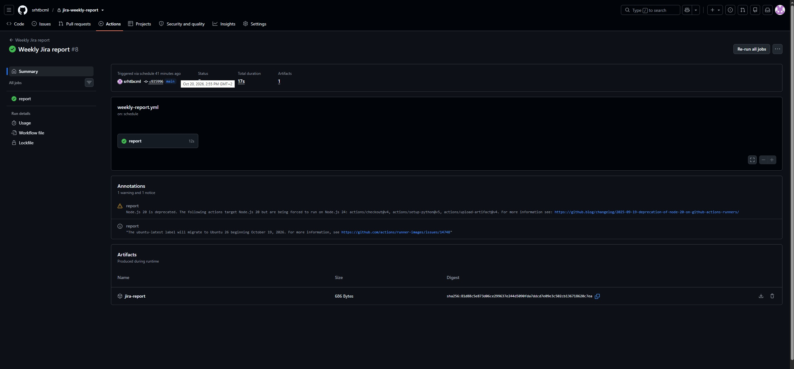

*10: Scheduled run #8: "Triggered via schedule", 20 Oct 2026, 14:55 (GMT+2).*

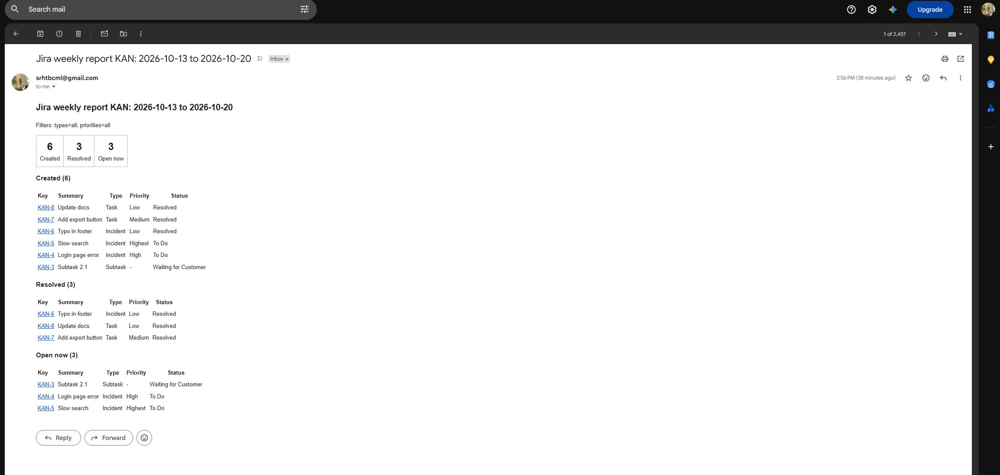

*09: The report email sent by run #8 at 14:56.*

Screenshots 07, 08, 09 and 10 come from the test version of the gate. The gate was set to a test hour (runs #4 to #7) and then opened for all hours (run #8), so that one scheduled email could be captured. The final gate is the one in the appendix.

## Assumptions and limits

1. "Past week" means 8 calendar days. With `--days 7` the window starts 7 days before the end date and both days count. On Monday 26 October the report covers 19 to 26 October. The last 7 full days (Monday to Sunday) would be cleaner. I kept the simple rule.
2. The final gate has not seen a real scheduled event yet. The first one is Monday 26 October 2026 at 09:00 UTC.
3. GitHub starts schedules late. In my tests a cron set to every 10 minutes ran 4 times in about 20 hours, and the first run came almost six hours after I saved the file. GitHub says scheduled runs can be delayed or dropped under load, so the email can arrive after 10:00. For a strict 10:00 I would use AWS EventBridge Scheduler (it supports the time zone `Europe/Berlin`) with AWS Lambda.
4. GitHub runs schedules only from the workflow file on the default branch (`main`).
5. An issue counts as resolved only if it has a resolution (see step 2).
6. Jira allows issues without a priority. The report shows `-` for them (KAN-3).
7. "Today" is the date in Berlin. Jira reads the query dates in the time zone of the Jira user, which I set to Europe/Berlin.
8. The report goes to the address in `MAIL_TO`. The script does not read the lead's address from Jira, because Jira may hide user emails from the API. Here `MAIL_TO` is the lead's address.
9. The Jira API token expires on 19 November 2026. After that, create a new token and update the secret `JIRA_API_TOKEN`.

## How I worked

I used an AI assistant (Claude) to draft the script, the workflow, the tests and this README, and to explain them to me. The assistant ran the unit tests and the checks of the gate logic in its own environment. I did all the work in Jira, Gmail and GitHub myself, started every workflow run, read the logs and compared the emails with the issue list in Jira. I also changed parts of the workflow myself during testing (the test gate), and I decided what the README should contain, what to cut and which screenshots to include.

## Appendix: the code

### `reportScript.py`

```python
#!/usr/bin/env python3
"""Weekly Jira report.

Counts the issues created, resolved and still open in one Jira Cloud project
and sends the result by email. It uses only the Jira REST API (no Jira Automation).
"""
import argparse
import html
import os
import smtplib
import sys
import time
from datetime import date, datetime, timedelta
from email.message import EmailMessage
from zoneinfo import ZoneInfo

import requests

FIELDS = "summary,status,priority,issuetype,created,resolutiondate"


def need(name):
    """Read a required setting from the environment."""
    value = os.environ.get(name, "").strip()
    if not value:
        sys.exit(f"ERROR: environment variable {name} is missing")
    return value


def jira_get(session, base, path, params):
    """GET with a few retries for network errors, 429 and 5xx."""
    for attempt in range(1, 4):
        try:
            r = session.get(base + path, params=params, timeout=30)
        except (requests.ConnectionError, requests.Timeout) as err:
            print(f"Network problem ({err.__class__.__name__}), try {attempt}/3")
            time.sleep(2 * attempt)
            continue
        if r.status_code == 429 or r.status_code >= 500:
            wait = int(r.headers.get("Retry-After", 2 * attempt))
            print(f"Jira answered {r.status_code}, waiting {wait}s, try {attempt}/3")
            time.sleep(wait)
            continue
        if r.status_code == 401:
            sys.exit("ERROR 401: JIRA_EMAIL or JIRA_API_TOKEN is wrong")
        if r.status_code == 403:
            sys.exit("ERROR 403: this user may not browse the project")
        if r.status_code == 400:
            sys.exit(f"ERROR 400: Jira rejected the query: {r.text[:300]}")
        if r.status_code >= 400:
            sys.exit(f"ERROR {r.status_code}: Jira refused the request: {r.text[:300]}")
        try:
            return r.json()
        except ValueError:
            sys.exit("ERROR: Jira did not send valid JSON")
    sys.exit("ERROR: Jira did not answer after 3 tries")


def search(session, base, jql):
    """Return every issue of a JQL query. Jira sends them in pages."""
    issues, token = [], None
    while True:
        params = {"jql": jql, "fields": FIELDS, "maxResults": 100}
        if token:
            params["nextPageToken"] = token
        data = jira_get(session, base, "/rest/api/3/search/jql", params)
        issues += data.get("issues", [])
        token = data.get("nextPageToken")
        if not token:
            return issues


def quote(text):
    return '"' + text.replace("\\", "\\\\").replace('"', '\\"') + '"'


def build_queries(project, start, end, types, priorities):
    extra = ""
    if types:
        extra += " AND issuetype in (" + ", ".join(quote(t) for t in types) + ")"
    if priorities:
        extra += " AND priority in (" + ", ".join(quote(p) for p in priorities) + ")"
    first = start.isoformat()
    after = (end + timedelta(days=1)).isoformat()  # the end day counts too
    base = f"project = {quote(project)}"
    return {
        "Created": f'{base} AND created >= "{first}" AND created < "{after}"{extra} ORDER BY created DESC',
        "Resolved": f'{base} AND resolved >= "{first}" AND resolved < "{after}"{extra} ORDER BY resolved DESC',
        "Open now": f"{base} AND statusCategory != Done{extra} ORDER BY created ASC",
    }


def parse_time(text):
    """Jira dates look like 2026-10-19T12:18:30.000+0200."""
    return datetime.strptime(text, "%Y-%m-%dT%H:%M:%S.%f%z")


def check_issue(item, list_name):
    """Return a list of warnings for one issue. An empty list means the data looks fine."""
    key = item.get("key")
    fields = item.get("fields") or {}
    if not key or not fields:
        return ["An issue came back without a key or without fields and was left out"]
    warnings = []
    created, resolved = fields.get("created"), fields.get("resolutiondate")
    if list_name == "Resolved" and not resolved:
        warnings.append(f"{key} is in the Resolved list but has no resolution date")
    if list_name == "Open now" and resolved:
        warnings.append(f"{key} is open but has a resolution date")
    if created and resolved:
        try:
            if parse_time(resolved) < parse_time(created):
                warnings.append(f"{key} was resolved before it was created")
        except ValueError:
            warnings.append(f"{key} has a date that could not be read")
    return warnings


def to_rows(issues, site):
    rows = []
    for item in issues:
        f = item.get("fields") or {}
        rows.append({
            "key": item.get("key", "?"),
            "summary": f.get("summary") or "(no summary)",
            "type": (f.get("issuetype") or {}).get("name", "-"),
            "priority": (f.get("priority") or {}).get("name", "-"),
            "status": (f.get("status") or {}).get("name", "-"),
            "url": f"{site}/browse/{item.get('key', '')}",
        })
    return rows


def make_report(project, start, end, sections, filters, warnings):
    title = f"Jira weekly report {project}: {start} to {end}"
    text = [title, filters, ""]
    page = [f"<h2>{html.escape(title)}</h2>", f"<p>{html.escape(filters)}</p>",
            "<table cellpadding='8' style='border-collapse:collapse'><tr>"]
    for name, rows in sections:
        page.append(f"<td style='border:1px solid #bbb;text-align:center'>"
                    f"<b style='font-size:24px'>{len(rows)}</b><br>{name}</td>")
        text.append(f"{name}: {len(rows)}")
    page.append("</tr></table>")
    for name, rows in sections:
        text += ["", f"{name} ({len(rows)})"]
        page.append(f"<h3>{name} ({len(rows)})</h3>")
        if not rows:
            text.append("  none")
            page.append("<p>None</p>")
            continue
        page.append("<table cellpadding='4' style='border-collapse:collapse'>"
                    "<tr><th align='left'>Key</th><th align='left'>Summary</th>"
                    "<th>Type</th><th>Priority</th><th>Status</th></tr>")
        for r in rows:
            text.append(f"  {r['key']}  {r['summary']}  [{r['type']}, {r['priority']}, {r['status']}]  {r['url']}")
            page.append(f"<tr><td><a href='{r['url']}'>{r['key']}</a></td>"
                        f"<td>{html.escape(r['summary'])}</td><td>{html.escape(r['type'])}</td>"
                        f"<td>{html.escape(r['priority'])}</td><td>{html.escape(r['status'])}</td></tr>")
        page.append("</table>")
    if warnings:
        text += ["", f"Data warnings ({len(warnings)})"] + [f"  - {w}" for w in warnings]
        page.append(f"<h3>Data warnings ({len(warnings)})</h3><ul>"
                    + "".join(f"<li>{html.escape(w)}</li>" for w in warnings) + "</ul>")
    return title, "\n".join(text), "".join(page)


def send_email(subject, text, page):
    msg = EmailMessage()
    msg["Subject"] = subject
    msg["From"] = need("MAIL_FROM")
    msg["To"] = need("MAIL_TO")
    msg.set_content(text)
    msg.add_alternative(page, subtype="html")
    host = need("SMTP_HOST")
    port = int(os.environ.get("SMTP_PORT", "587"))
    try:
        with smtplib.SMTP(host, port, timeout=30) as server:
            server.starttls()
            server.login(need("SMTP_USER"), need("SMTP_PASSWORD"))
            server.send_message(msg)
    except (smtplib.SMTPException, OSError) as err:
        sys.exit(f"ERROR: the email could not be sent: {err}")


def main():
    ap = argparse.ArgumentParser(description="Weekly Jira report by email")
    ap.add_argument("--project", required=True, help="Jira project key, for example KAN")
    ap.add_argument("--days", type=int, default=7, help="how many days back (default 7)")
    ap.add_argument("--from", dest="start", help="first day, YYYY-MM-DD (replaces --days)")
    ap.add_argument("--to", dest="end", help="last day, YYYY-MM-DD (default: today)")
    ap.add_argument("--types", help="only these issue types, comma separated")
    ap.add_argument("--priorities", help="only these priorities, comma separated")
    ap.add_argument("--no-email", action="store_true", help="print the report, send nothing")
    a = ap.parse_args()

    today = datetime.now(ZoneInfo("Europe/Berlin")).date()  # "today" in Berlin, not in the runner's UTC
    end = date.fromisoformat(a.end) if a.end else today
    start = date.fromisoformat(a.start) if a.start else end - timedelta(days=a.days)
    if start > end:
        sys.exit("ERROR: the start date is after the end date")
    types = [t.strip() for t in a.types.split(",")] if a.types else []
    priorities = [p.strip() for p in a.priorities.split(",")] if a.priorities else []

    site = need("JIRA_BASE_URL").rstrip("/")
    session = requests.Session()
    session.auth = (need("JIRA_EMAIL"), need("JIRA_API_TOKEN"))
    session.headers["Accept"] = "application/json"

    sections, warnings = [], []
    for name, jql in build_queries(a.project, start, end, types, priorities).items():
        print(f"{name}: {jql}")
        issues = search(session, site, jql)
        for item in issues:
            warnings += check_issue(item, name)
        usable = [i for i in issues if i.get("key") and i.get("fields")]
        sections.append((name, to_rows(usable, site)))
    warnings = list(dict.fromkeys(warnings))  # the same warning only once

    filters = f"Filters: types={', '.join(types) or 'all'}; priorities={', '.join(priorities) or 'all'}"
    subject, text, page = make_report(a.project, start, end, sections, filters, warnings)

    os.makedirs("reports", exist_ok=True)
    with open(f"reports/{a.project}_{end}.html", "w", encoding="utf-8") as fh:
        fh.write(page)

    print()
    print(text)
    if not a.no_email:
        send_email(subject, text, page)
        print("\nEmail sent.")


if __name__ == "__main__":
    main()
```

### `test_report.py`

```python
"""Small tests for reportScript.py. They need no network and no Jira.

Run:  python test_report.py
"""
from datetime import date

import requests

import reportScript as rs

rs.time.sleep = lambda seconds: None  # do not really wait in the retry tests


class FakeResponse:
    def __init__(self, status=200, body=None, headers=None, text=""):
        self.status_code = status
        self.headers = headers or {}
        self.text = text
        self._body = body

    def json(self):
        if self._body is None:
            raise ValueError("not json")
        return self._body


class FakeSession:
    """Gives back the prepared answers one by one."""

    def __init__(self, answers):
        self.answers = list(answers)
        self.calls = 0

    def get(self, url, params=None, timeout=None):
        self.calls += 1
        answer = self.answers.pop(0)
        if isinstance(answer, Exception):
            raise answer
        return answer


def exit_text(function, *args):
    """Run a function that should stop the program and return its message."""
    try:
        function(*args)
    except SystemExit as stop:
        return str(stop)
    raise AssertionError("the program did not stop")


def test_retry_then_success():
    session = FakeSession([requests.Timeout(), FakeResponse(500), FakeResponse(200, {"ok": 1})])
    assert rs.jira_get(session, "https://x", "/p", {}) == {"ok": 1}
    assert session.calls == 3


def test_retry_gives_up():
    session = FakeSession([requests.ConnectionError()] * 3)
    assert "3 tries" in exit_text(rs.jira_get, session, "https://x", "/p", {})


def test_rate_limit_uses_retry_after():
    session = FakeSession([FakeResponse(429, headers={"Retry-After": "1"}), FakeResponse(200, {"ok": 1})])
    assert rs.jira_get(session, "https://x", "/p", {}) == {"ok": 1}


def test_clear_errors():
    assert "401" in exit_text(rs.jira_get, FakeSession([FakeResponse(401)]), "https://x", "/p", {})
    assert "403" in exit_text(rs.jira_get, FakeSession([FakeResponse(403)]), "https://x", "/p", {})
    assert "400" in exit_text(rs.jira_get, FakeSession([FakeResponse(400, text="bad jql")]), "https://x", "/p", {})
    assert "404" in exit_text(rs.jira_get, FakeSession([FakeResponse(404, text="gone")]), "https://x", "/p", {})
    assert "valid JSON" in exit_text(rs.jira_get, FakeSession([FakeResponse(200)]), "https://x", "/p", {})


def test_paging_follows_the_token():
    session = FakeSession([
        FakeResponse(200, {"issues": [{"key": "A-1"}], "nextPageToken": "t2"}),
        FakeResponse(200, {"issues": [{"key": "A-2"}]}),
    ])
    assert [i["key"] for i in rs.search(session, "https://x", "jql")] == ["A-1", "A-2"]
    assert session.calls == 2


def test_queries():
    q = rs.build_queries("KAN", date(2026, 10, 12), date(2026, 10, 19), ["Task"], ["High"])
    assert 'created >= "2026-10-12" AND created < "2026-10-20"' in q["Created"]
    assert 'issuetype in ("Task")' in q["Open now"]
    assert 'priority in ("High")' in q["Resolved"]
    assert rs.quote('a"b') == '"a\\"b"'


def issue(key="A-1", created="2026-10-19T10:00:00.000+0200", resolved=None):
    return {"key": key, "fields": {"created": created, "resolutiondate": resolved}}


def test_data_warnings():
    assert rs.check_issue(issue(), "Created") == []
    assert rs.check_issue(issue(resolved="2026-10-19T12:00:00.000+0200"), "Resolved") == []
    assert "no resolution date" in rs.check_issue(issue(), "Resolved")[0]
    assert "open but has a resolution date" in rs.check_issue(
        issue(resolved="2026-10-19T12:00:00.000+0200"), "Open now")[0]
    assert "before it was created" in rs.check_issue(
        issue(resolved="2026-10-19T08:00:00.000+0200"), "Resolved")[0]
    # the same moment written with two different offsets is not an error
    assert rs.check_issue(issue(resolved="2026-10-19T08:30:00.000+0000"), "Resolved") == []
    assert "could not be read" in rs.check_issue(issue(resolved="yesterday"), "Resolved")[0]
    assert "without a key" in rs.check_issue({"fields": {}}, "Created")[0]


def test_report_shows_warnings():
    sections = [("Created", []), ("Resolved", []), ("Open now", [])]
    title, text, page = rs.make_report("KAN", date(2026, 10, 12), date(2026, 10, 19), sections,
                                       "Filters: types=all; priorities=all", ["A-1 is odd"])
    assert "Data warnings (1)" in text and "A-1 is odd" in text
    assert "Data warnings (1)" in page
    _, text, _ = rs.make_report("KAN", date(2026, 10, 12), date(2026, 10, 19), sections, "f", [])
    assert "Data warnings" not in text


if __name__ == "__main__":
    tests = [name for name in dir() if name.startswith("test_")]
    for name in tests:
        globals()[name]()
        print("ok  ", name)
    print(f"\nAll {len(tests)} tests passed.")
```

### `.github/workflows/weekly-report.yml`

```yaml
name: Weekly Jira report

on:
  schedule:
    - cron: "0 8 * * 1"   # 10:00 Berlin in summer time (UTC+2)
    - cron: "0 9 * * 1"   # 10:00 Berlin in winter time (UTC+1)
  workflow_dispatch:
    inputs:
      extra_args:
        description: "Extra options, for example: --days 30 --types Task"
        required: false
        default: ""

permissions:
  contents: read

jobs:
  report:
    runs-on: ubuntu-latest
    steps:
      - name: Check the Berlin time
        id: gate
        env:
          EVENT: ${{ github.event_name }}
          CRON: ${{ github.event.schedule }}
        run: |
          offset=$(TZ=Europe/Berlin date +%z)
          echo "Trigger: $EVENT, cron: $CRON, Berlin offset: $offset"
          run=true
          if [ "$EVENT" = "schedule" ]; then
            run=false
            if [ "$CRON" = "0 8 * * 1" ] && [ "$offset" = "+0200" ]; then run=true; fi
            if [ "$CRON" = "0 9 * * 1" ] && [ "$offset" = "+0100" ]; then run=true; fi
          fi
          echo "Run the report: $run"
          echo "run=$run" >> "$GITHUB_OUTPUT"

      - name: Get the code
        if: steps.gate.outputs.run == 'true'
        uses: actions/checkout@v4

      - name: Install Python
        if: steps.gate.outputs.run == 'true'
        uses: actions/setup-python@v5
        with:
          python-version: "3.12"

      - name: Install requests
        if: steps.gate.outputs.run == 'true'
        run: pip install requests

      - name: Run the report
        if: steps.gate.outputs.run == 'true'
        env:
          JIRA_BASE_URL: ${{ secrets.JIRA_BASE_URL }}
          JIRA_EMAIL: ${{ secrets.JIRA_EMAIL }}
          JIRA_API_TOKEN: ${{ secrets.JIRA_API_TOKEN }}
          SMTP_HOST: ${{ secrets.SMTP_HOST }}
          SMTP_PORT: ${{ secrets.SMTP_PORT }}
          SMTP_USER: ${{ secrets.SMTP_USER }}
          SMTP_PASSWORD: ${{ secrets.SMTP_PASSWORD }}
          MAIL_FROM: ${{ secrets.MAIL_FROM }}
          MAIL_TO: ${{ secrets.MAIL_TO }}
          EXTRA_ARGS: ${{ inputs.extra_args }}
        run: python reportScript.py --project KAN $EXTRA_ARGS

      - name: Keep the HTML report
        if: steps.gate.outputs.run == 'true'
        uses: actions/upload-artifact@v4
        with:
          name: jira-report
          path: reports/
```
